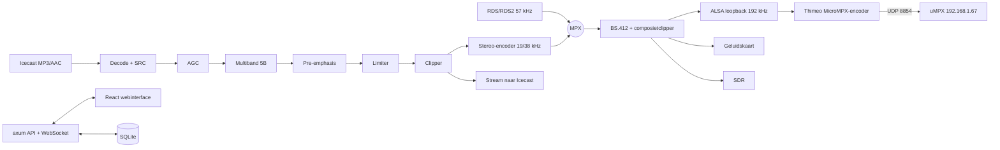

# PILOT — Fase 1: onderzoek en ontwerp

Status: **voorstel, wacht op akkoord** · 28-11-2026

Dit document legt vast hoe PILOT gebouwd wordt: hoe het signaal bij de zender komt,
welke techniek we gebruiken en hoe de onderdelen samenwerken. Fase 2 (audio-engine)
begint pas na akkoord.

---

## 1. De route naar de zender: MicroMPX

### Wat we hebben
Phantomtronics uMPX Decoder (192.168.1.67) → BNC MPX → Elenos Indium. Deva DB45 als off-air monitor.

### Wat het onderzoek oplevert
- MicroMPX is een **gesloten protocol** van Thimeo. De codec zelf is niet gedocumenteerd;
  alleen de bediening (een JSON-API op de webinterface) is beschreven.
- Het verkeer is **eenrichtings-UDP**, standaardpoort **8854**, bitrate vanaf **320 kbit/s**
  (versie 4: tot 800 kbit/s, met MicroMPX+ omlaag tot 176 kbit/s; extra licentie).
  Met foutcorrectie 64/8 wordt het 360 kbit/s en heeft de decoder minimaal ~0,7 s vertraging nodig
  (1 s is het gebruikelijke voorbeeld).
- De **officiële Thimeo MicroMPX-encoder draait op Linux** (ook headless, bediening via een webinterface)
  en neemt zijn invoer van een **geluidskaart op 192 kHz**. Daar mag een kant-en-klaar MPX-signaal op
  binnenkomen (pilot en RDS zitten er dan al in).
- De encoder-licentie is **levenslang en gekoppeld aan één apparaat**. Zonder licentie werkt hij
  volledig, maar komen er af en toe tonen in de audio. De prijs staat niet online; die moeten we
  opvragen bij Thimeo of een dealer.
- Phantomtronics staat bij Thimeo vermeld als officiële MicroMPX-partner. GPS-synchronisatie
  werkt niet met hardware van derden (voor ons niet nodig, we hebben één zender).

### Besluit
**We schrijven MicroMPX niet zelf na.** Het protocol nabouwen is juridisch riskant (licentie-voorwaarden
van Thimeo) en technisch onbetrouwbaar: één fout en de zender valt stil. In plaats daarvan:

```
PILOT-engine ──(192 kHz MPX via virtuele geluidskaart)──▶ Thimeo MicroMPX-encoder ──UDP 8854──▶ uMPX → Indium
```

- PILOT maakt het complete MPX-signaal zelf (processing, stereo, pilot, RDS, MPX-limiter).
- Dat signaal gaat via een **ALSA-loopback** (`snd-aloop`, een virtuele geluidskaart) in dezelfde
  container naar de officiële encoder. Geen extra hardware nodig.
- PILOT bestuurt en bewaakt de encoder via zijn JSON-API, zodat status, bitrate en verbinding gewoon
  in de PILOT-interface staan.
- Omdat de encoder het MPX-signaal één-op-één doorgeeft, blijven onze deviatie- en MPX-powerlimieten
  leidend.

**Actie voor Reinder:** een MicroMPX-encoderlicentie aanschaffen (prijs opvragen bij Thimeo of de dealer
van de uMPX). Tot die tijd kunnen we testen met de ongelicenseerde versie.

---

## 2. Techniekkeuze

| Onderdeel | Keuze | Waarom |
|---|---|---|
| DSP-engine | **Rust** | Realtime-veilig zonder garbage collector, geheugenveilig (geen crashes door geheugenfouten in een 24/7-proces), snel als C++. |
| Icecast-invoer | `reqwest` + ICY-metadata, decoderen met **Symphonia** (MP3, AAC) | Pure Rust, geen externe codecs nodig. Metadata voedt de dynamische RadioText. |
| Resampling | `rubato` | Hoogwaardige sample-rate-conversie 44,1/48 kHz → 192 kHz. |
| Audioprocessing | Eigen DSP in Rust | AGC, 5-band Linkwitz-Riley-multiband, pre-emphasis 50/75 µs, look-ahead limiter, 8× oversampled clipper. |
| Stereo en RDS | Eigen encoder op 192 kHz | Pilot 19 kHz fase-gelockt, L−R op 38 kHz, RDS/RDS2 BPSK op 57 kHz (+ RDS2-subdragers 66,5/71,25/76 kHz). |
| Veiligheid | BS.412 MPX-powerlimiter + composietclipper met notches op 19 en 57 kHz | Harde grens: de zender komt nooit buiten zijn stokken, ongeacht de UI-instellingen. |
| Meters | `ebur128` voor LUFS, eigen deviatie/MPX-power | Volgens EBU R128 en ITU-R BS.412. |
| Uitgangen | ALSA (geluidskaart en loopback naar MicroMPX), **SoapySDR** (HackRF/LimeSDR/Pluto), ffmpeg (stream terug naar Icecast) | Alles los aan/uit te zetten in de UI. |
| Backend / API | **Rust, axum**, in hetzelfde programma | Eén binary, één service. REST voor instellingen, WebSocket voor live meters (30 fps). |
| Opslag | **SQLite** | Instellingen, presets, gebruikers, logboek. Klein en makkelijk te back-uppen. |
| Webinterface | **React + TypeScript + Vite**, Tailwind met de PILOT-tokens, **i18next** (EN standaard, NL) | Modern, snel, meters op canvas. Wordt in de binary meegebakken. |
| Mail | `lettre` met rustls | Eigen SMTP-server instelbaar: STARTTLS, SSL/TLS, AUTH PLAIN/LOGIN/XOAUTH2, TLS 1.3. |
| Back-ups | tar + zstd; FTP/FTPS via `suppaftp`, SCP via `russh` | Full en incremental (manifest met hashes), restore vanaf elke externe locatie. |
| Updates | GitHub Releases, `.deb`-pakket, minisign-handtekening | Productie = releases uit `main`, test = pre-releases uit `test`. Wisselen en updaten vanuit de Info-knop, met automatische terugval bij een mislukte update. |

---

## 3. Architectuur



- **Realtime-thread**: de hele audioketen draait in één thread met hoge prioriteit en blokken van 5 ms.
  De webinterface praat er alleen via lock-vrije wachtrijen mee, zodat de UI het geluid nooit kan laten haperen.
- **Instellingen wijzigen live**, zonder klik of onderbreking (parameters worden geleidelijk overgezet).
- **Terugval**: valt de Icecast-stream weg, dan schakelt PILOT naar de back-upstream of een lokaal bestand
  en stuurt een mail.

---

## 4. Debian 13 LXC-container

- `systemd`-service `pilot.service`, draait als eigen gebruiker.
- Op de Proxmox-host: `snd-aloop` laden en `/dev/snd` doorgeven aan de container (voor loopback en een eventuele geluidskaart).
- Realtime-prioriteit toestaan in de container (`rtprio` via limits).
- De Thimeo MicroMPX-encoder draait als tweede service in dezelfde container.
- Webinterface op poort 443 (zelfondertekend of Let's Encrypt), met login.

---

## 5. Branches en versies

- `main` = **productie**. Alleen geteste versies; releases `vX.Y.Z`.
- `test` = **test**. Nieuwe functies eerst hier; pre-releases `vX.Y.Z-rc.N`.
- In de Info-knop kies je het kanaal en installeer je updates.

---

## 6. Planning vervolg

1. **Fase 2, audio-engine**: Icecast-invoer → processing → stereo + RDS → MPX-limiter → loopback → MicroMPX. Eerst testen op de geluidskaart-uitgang en met de DB45 terugmeten.
2. **Fase 3, webinterface** op basis van de goedgekeurde mockup (`branding/mockup`).
3. **Fase 4, standaardpakket en uitrol**: mail, back-ups, updates, installatie in de LXC.

## Bronnen

- Thimeo MicroMPX: https://www.thimeo.com/micrompx
- MicroMPX-licenties: https://www.thimeo.com/micrompx/licenses-micrompx
- MicroMPX-handleiding: https://download.thimeo.com/MicroMPX_manual.pdf
